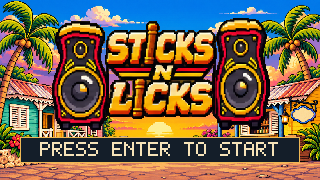

# Milestone 007 UI polish

Implemented on `development` after `a57870d`, alongside Milestone 008. Original PNGs, the font atlas, character animation resources, intro cue map and original music are unchanged.

## Root causes and corrections

The CTA was a sibling Label drawn at the panel's exact (20,137) origin with a duplicated fixed size of 280×22. Horizontal alignment was already centred, but the Label used default top alignment and neither node reserved border/content margins. The 16px font line box and 1px shadow could therefore approach the top border without intentional vertical padding. The panel did not own the label's layout.

`ArcadeIntro.prompt_panel` is now a **PanelContainer**. Its StyleBox owns symmetric margins: 1px border plus 6px horizontal / 4px vertical padding. The Label is its child, centred on both axes. Godot measures the existing font and determines the container's minimum height. The width remains 280 and the font remains 16; height grows modestly from 22 to **26**, rather than shrinking the text or moving it by a screenshot-specific offset.

Measured native geometry from `tests/test_ui_polish.gd`:

| Item | Logical pixels |
| --- | --- |
| Panel | (20,137), 280×26 |
| Usable content, local to panel | (7,5), 266×16 |
| Actual font line box | 240×16 |
| Centred line box, in viewport | (40,142), 240×16 |

The line box has equal 20px horizontal space within the panel and equal 5px vertical space. Font descent/shadow remain inside the reserved content area. Container geometry remains stable while the logo bounces and the prompt shows, dims, skips or hides. The original reveal time, pulse opacity and Enter rules are unchanged.

The round HUD used light text with only a 1px shadow. Bright clouds, water and busy buildings could erase its silhouette. `PixelAnnouncement` now gives all single-line HUD announcements—including round/BPM/phase, countdown, GO, instructions, outcomes and footer—a consistent treatment:

- Warm ivory `#FFE2A0`; GO retains its existing gold `#EEC65E` distinction.
- Dark navy `#172235`, 2 logical pixels of discrete outline.
- Restrained `#080F1B` shadow at (+2,+3) logical pixels.
- Original bitmap glyphs drawn directly with `Font.draw_char`; nearest filtering, no blur, glow, font replacement or generated art.

This pixel-compatible path works with the existing bitmap font instead of relying on dynamic outline glyph support. Offsets are divided by the Label's current scale so the stroke remains **2 native pixels**, even during the existing 4×→3× countdown pulse. Text origins are rounded on the final native grid. No duplicate Label nodes or per-frame scene allocations are needed. The Label still owns its semantic text and normal layout metrics.

The major label moves from Y=50 to **Y=45**, reserving room for its maximum uppercase glyph ink, outline and shadow before instructions at Y=79. The 80ms countdown pulse, cue thresholds and all musical timing remain unchanged. The HUD remains in CanvasLayer 10 above scenery, fighters and the environmental speaker; text does not clip to its control bounds. Legacy multiline help remains on its opaque panel.

## Graphical verification

Before screenshots were captured before source edits, showing the original CTA and Village Street announcements. Current screenshots cover **all eight actual stage entries / six distinct source images**:

| Stage | Contrast case |
| --- | --- |
| Village Street | Bright sky and colourful houses |
| Beach Courtyard | Bright sea/white clouds and palms |
| Crop Over Festival | Busy decorations, sunset and animated speaker |
| Fish Fry | Dark sky, bright lamps, signs and foreground detail |
| Seafront Street | Bright sky, pale architecture and shadows |
| Fish Fry Copy | Existing byte-identical Fish Fry image |
| Speightstown | Existing byte-identical Seafront image |
| Animal Flower Cave | Dark cave against bright sky, sea and waterfall |

The gallery asserts that match setup actually selected the requested stage; it cannot silently fall back to Stage 01. It checks rendered countdown fill pixels as well as taking screenshots. The original intro still uses **only** `bim_sky` and `bim_foreground`. CTA-over-stage images are explicit contrast stress fixtures: the existing panel is temporarily placed in the test CanvasLayer, not used as a replacement intro background or normal gameplay overlay.

Inspected native 320×180 and actual Godot desktop captures with 1280×720 content, plus a 960×540 window. The automated layout test additionally resizes to 640×360. The CTA remains contained and legible in bright/dim states. Round metadata, 3/2/1, GO, pickup instructions and footer remain above scenery with crisp contours. No text/border clipping or overlap between countdown and instructions was observed. Source artwork is preserved, including existing duplicate stages.




Additional before/after/native/desktop images are in `docs/screenshots/milestone-007-ui-polish/`. Before evidence is deliberately limited to the original CTA and Village Street; all-stage verification refers to the corrected implementation.

## Tests and recording

`bash tools/check.sh` exited **0**, including the 900-match CPU matrix (1,795,853 checks), 29 Python tests and all prior regressions. The focused UI suite passed **200 checks** covering measured content bounds, symmetric padding, centring, viewport containment, animation/cue stability, outline colours/width, layer order, all stage entries and countdown scale/timing. Its metrics are recorded in `milestone-007-ui-polish-evidence.json`. Final focused UI/audio checks were repeated after cleanup and passed without new resource-leak warnings.

The continuous UI recording is **`output/ui-polish.avi`**, 1,119 frames at 60 FPS (**18.65 seconds**). It shows the corrected title CTA and the CTA/countdown/GO treatment across every stage. It is a silent native fixture gallery with injected/held timestamps for readability inspection, not physical keyboard playtesting or a claim about real-time animation pacing. Production countdown timing is checked separately, and the Milestone 008 movie shows the running round lifecycle.

```sh
/Applications/Godot.app/Contents/MacOS/Godot --path . \
  --log-file output/polish-movie.log --fixed-fps 60 \
  --write-movie output/ui-polish.avi \
  --script tests/ui_polish_gallery.gd -- \
  --polish=after --record-polish --desktop-polish
```

Desktop captures use the existing optional `output/capture-game-window` helper built from `tools/capture_game_window.swift`; it captures only the Godot PID's actual window. Generated movies/binaries remain ignored in `output/`. Human readability/preferences on the owner's display remain subjective review; scripted screenshots are not physical playtesting.
